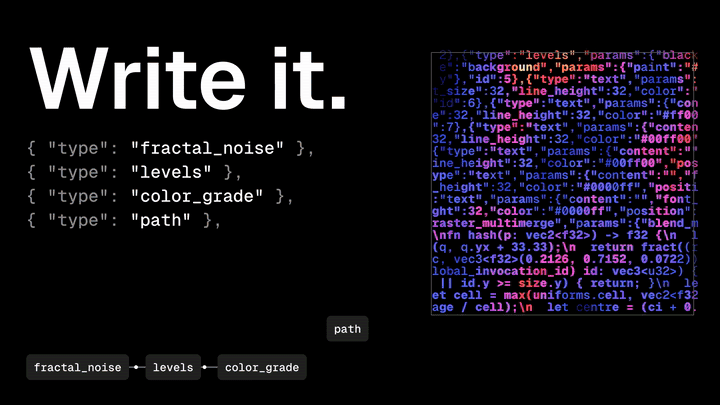
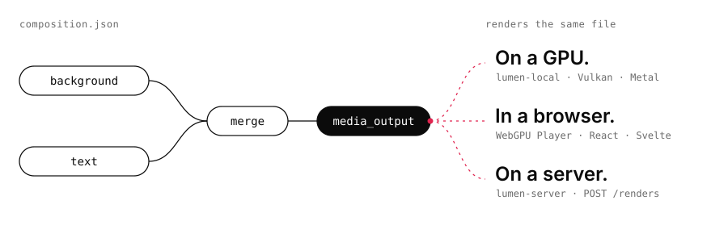

<div align="center">



<sub>A video is a file. Every frame above is one JSON composition, written with the Lumen SDK and rendered by Lumen.</sub>

<h1>Lumen</h1>

<p><b>A GPU renderer for videos written as code.</b><br/>Wire nodes into a composition, then render the same file on a GPU, in a browser, or on a server.</p>

<p>
<a href="https://www.npmjs.com/package/@lumiscia/lumen-sdk"></a>
<a href="https://github.com/lumiscia/lumen-oss/actions/workflows/ci.yml"></a>
<a href="LICENSE"></a>
</p>

<p>
<a href="#quickstart">Quickstart</a> ·
<a href="https://github.com/lumiscia/docs">Docs</a> ·
<a href="docs/3d.md">3D</a> ·
<a href="examples/README.md">Examples</a> ·
<a href="crates/server/README.md">Self-hosting</a> ·
<a href="https://lumiscia.com">Lumiscia (soon)</a>
</p>

</div>

---

Lumen is the open-source rendering core of [Lumiscia](https://lumiscia.com), a hosted rendering platform that is launching soon. A composition is a graph of typed nodes (text, shapes, media, noise, shaders, blurs, grades, audio) saved as one JSON file. You can diff it, generate it, review it, and render it anywhere Lumen runs.

<picture>
  <source media="(prefers-color-scheme: dark)" srcset=".github/readme/graph-dark.svg" />
  
</picture>

> [!NOTE]
> **Lumiscia hasn't launched yet.** Until it does, you render with Lumen yourself: a local [`lumen-server`](crates/server/README.md), the `lumen` CLI, or the browser `Player`. The SDK already speaks the hosted API, so the same code will point at Lumiscia when it opens.
>
> Lumen itself is in heavy beta. Crate APIs, schema shapes and node behaviour still change between releases.

## Quickstart

```bash
pnpm add @lumiscia/lumen-sdk
```

**1. Write it.** This is the graph drawn above.

```ts
import { Composition } from "@lumiscia/lumen-sdk";

export const composition = new Composition({ timeline: { durationSeconds: 3 } });
const bg = composition.addNode({ type: "background", params: { paint: [24, 28, 36, 255] } });
const title = composition.addNode({
  type: "text",
  params: { content: "Hello, Lumen", font_size: 120, position: [96, 480] },
});
const merged = composition.addNode({ type: "merge", inputs: { base: bg, overlay: title } });
composition.addNode({ type: "media_output", inputs: { source: merged } });
```

Or as nested node values, with the same node names, ports and JSON:

```ts
import { Composition, nodes as n } from "@lumiscia/lumen-sdk";

export const composition = new Composition({ timeline: { durationSeconds: 3 } }).addOutput(
  n.merge({
    base: n.background({ paint: [24, 28, 36, 255] }),
    overlay: n.text({ content: "Hello, Lumen", font_size: 120, position: [96, 480] }),
  }),
);
```

**2. Render it.** Start a [`lumen-server`](crates/server/README.md) on your GPU machine:

```bash
cargo run -p lumen-server --features cli --bin lumen-server -- --bind 127.0.0.1:8080
```

Then send it the composition and print the URL of the MP4. A server on loopback needs no token; set `--token` for anything else and pass it as `apiKey`.

```ts
import { Lumen } from "@lumiscia/lumen-sdk";
import { composition } from "./composition.js";

const lumen = new Lumen({ apiKey: "local", baseUrl: "http://127.0.0.1:8080" });
const render = await lumen.render(composition);
console.log((await lumen.waitForRender(render)).url);
```

Once Lumiscia launches, drop `baseUrl` and pass your Lumiscia API key instead.

To render a composition JSON file without a server, install the [`lumen` CLI](crates/cli/README.md), which comes with FFmpeg built in:

```bash
npm install -g @lumiscia/lumen-cli
lumen render composition.json -o out.mp4
```

**3. Preview it.** In the browser with WebGPU, using `@lumiscia/lumen-react` or `@lumiscia/lumen-svelte`:

```tsx
import { Player, createLumenPreview } from "@lumiscia/lumen-react";
import { composition } from "./composition.js";

const preview = createLumenPreview();

export const App = () => (
  <>
    <Player preview={preview} composition={composition} style={{ width: 640 }} />
    <button onClick={() => preview.play()}>Play</button>
  </>
);
```

The [documentation](https://github.com/lumiscia/docs) covers every node, media, audio and fonts. The [3D guide](docs/3d.md) covers scenes, cameras, lights and glTF models, and the [node reference](docs/node-reference.md) lists every node and param. [`examples/`](examples/README.md) has complete apps and 3D compositions.

## Where it runs

|             | Rendering        | Encoding                                                                       |
| ----------- | ---------------- | ------------------------------------------------------------------------------ |
| **Linux**   | Vulkan           | Vulkan Video (`h264_vulkan`, `hevc_vulkan`, `av1_vulkan`), optional CUDA/NVENC |
| **macOS**   | Metal            | VideoToolbox                                                                   |
| **Browser** | WebGPU (preview) | —                                                                              |
| **Windows** | Development only | See [docs/windows.md](docs/windows.md)                                         |

Lumen needs a GPU for its main render paths. [docs/support-matrix.md](docs/support-matrix.md) lists the adapters, encoders and CI coverage.

## Self-hosted today, hosted soon

**Self-hosted** is how you run Lumen today. [`crates/server`](crates/server/README.md) is an embeddable render library and a small HTTP server: it accepts hosted-style payloads, takes media uploads, renders locally, reports progress and returns an MP4. Beyond a single process, you bring the rest: GPU machines, FFmpeg, queueing, durable storage, auth, deployment and monitoring.

**Hosted** is [Lumiscia](https://lumiscia.com), launching soon. It runs Lumen on managed GPUs with storage, delivery and collaboration, and takes the same compositions.

## What's in this repository

<table>
<tr><th>Rust crates</th><th>TypeScript packages</th></tr>
<tr valign="top"><td>

| Crate               | Role                                                  |
| ------------------- | ----------------------------------------------------- |
| `crates/engine`     | Composition model, nodes, media, render orchestration |
| `crates/gpu`        | `wgpu` resources, programs, passes, Vulkan export     |
| `crates/ffmpeg`     | Decode, encode, muxing, GPU frame interop             |
| `crates/server`     | Render library and local HTTP server                  |
| `crates/cli`        | `lumen` render and debug CLI                          |
| `crates/text`       | Text layout and glyph data                            |
| `crates/3d`         | Meshes, transforms, cameras and draw order for 3D     |
| `crates/wasm`       | The preview renderer for WebAssembly                  |
| `crates/bench`      | Composition and decode benchmarks                     |
| `crates/generators` | Schema and metadata generators                        |
| `crates/macros`     | Node metadata proc macros                             |

</td><td>

| Package          | Role                                      |
| ---------------- | ----------------------------------------- |
| `lumen-sdk`      | Render API client and composition builder |
| `lumen-shared`   | Dependency-light composition builder      |
| `lumen-types`    | Generated schema and metadata types       |
| `lumen-preview`  | Browser preview engine and media bridge   |
| `lumen-bindings` | The renderer compiled to WebAssembly      |
| `lumen-react`    | `Player` for React                        |
| `lumen-svelte`   | `Player` for Svelte                       |
| `lumen-cli`      | The `lumen` CLI as prebuilt binaries      |

</td></tr>
</table>

`definitions/` holds the generated node metadata and JSON schemas. Product, billing and hosted-service code live outside this repository.

## Development

```bash
pnpm install
just wasm-bindings-debug   # once per clean checkout; compiles the renderer to WebAssembly
pnpm build                 # packages resolve each other through their built output
pnpm check && pnpm test
cargo check && cargo test
```

<details>
<summary>Native targets, generated code and bindings</summary>

```bash
cargo check -p lumen-server --features vulkan,cuda --lib
cargo check -p lumen-server --features metal --lib

just generate-definitions
just generate-types
```

`just wasm-bindings-debug` and `just wasm-bindings-release` write the bindings into `packages/lumen-bindings/wasm`, which is not committed. They need the `wasm32-unknown-unknown` target and `wasm-bindgen-cli` at the version pinned in `crates/wasm/Cargo.toml`. Use `debug` while developing and `release` for a size-optimised build.

</details>

See [CONTRIBUTING.md](CONTRIBUTING.md) before opening a pull request.

## License

[Apache 2.0](LICENSE)
